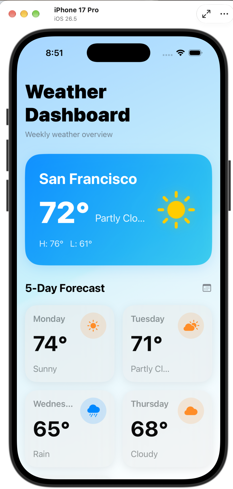
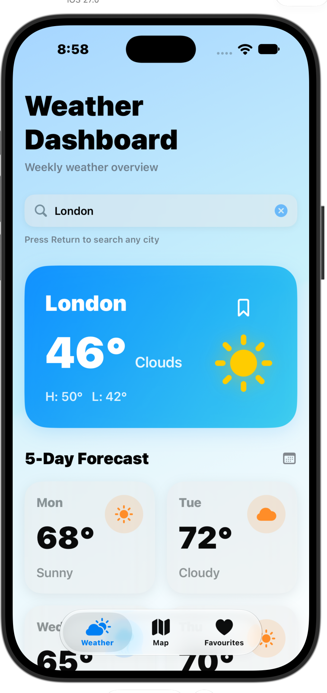
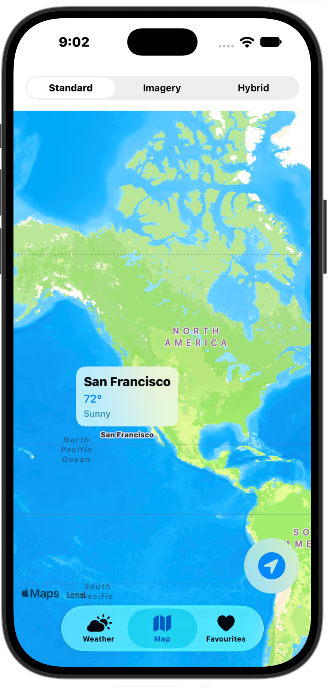

# laughing-doodle
# Weather Dashboard

A clean, modern iOS weather app built with **SwiftUI**. Search any city to see current conditions and a 5-day forecast, view weather on an interactive map, and save favourite cities.

Inspired by the IBM course *Developing iOS Apps with Swift*.

<table>
  <tr>
    <td align="center"></td>
    <td align="center"></td>
    <td align="center"></td>
  </tr>
  <tr>
    <td align="center"><b>Dashboard</b></td>
    <td align="center"><b>City search</b></td>
    <td align="center"><b>Map view</b></td>
  </tr>
</table>

---

## Features

- **City search**: type any city and press Return to load its weather
- **Current conditions**: temperature, condition, and daily high/low on a gradient card
- **5-day forecast**: adaptive grid of forecast cards that fits iPhone and iPad
- **Interactive map**: Standard, Imagery and Hybrid map styles with weather callouts and a "my location" button
- **Favourites**: bookmark cities and open them from the Favourites tab
- **Tab navigation**: Weather, Map and Favourites tabs

## Tech Stack

| Area | Technology |
|---|---|
| Language | Swift |
| UI framework | SwiftUI |
| Maps | MapKit |
| State management | Observation framework (`@Observable` view model) |
| Layout | `ScrollView`, `LazyVGrid`, `LazyHGrid`, `TabView` |
| Icons | SF Symbols |

## Requirements

- Xcode 26 or later
- iOS 26.5 or later

## Getting Started

1. Clone the repository:
   ```bash
   git clone https://github.com/CaptTauhid5832/laughing-doodle.git
   cd laughing-doodle
   ```
2. Open the project in Xcode (double-click the `.xcodeproj` file).
3. Choose an iPhone simulator and press **Run** (`⌘R`).

## Possible Next Steps

- Hourly forecast for searched cities
- °C / °F switching
- Home Screen widget

## License

This project is licensed under the **Apache License 2.0**. See the [LICENSE](LICENSE) file for details.

## Author

**Capt. Tauhid** (L K Tauhidur Rahman)
GitHub: [CaptTauhid5832](https://github.com/CaptTauhid5832)
